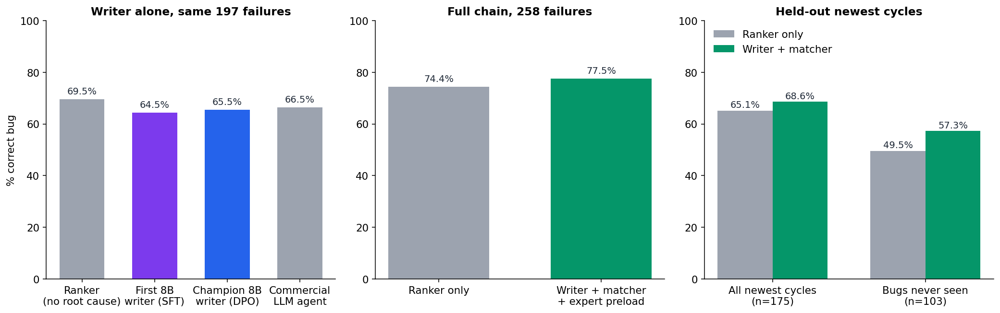

# End-to-end architecture and data pipeline

**Results (latest champions).** The local stack (ranker, expert preload, writer, matcher) gets the right bug on **77.5%** of 258 failures
vs **74.4%** for the ranker alone (p = 0.039), at **0 API cost**. The 8B root-cause writer ties a commercial LLM agent (128 vs 130 of 196 shared).
On newer, never-seen cycles the chain scores 68.6% vs 65.1%, and 57.3% vs 49.5% on bugs the ranker never saw.
The first-version benchmark chart is in the [overview](../README.md).

## How the pieces connect
1. **Evidence**: run metadata, log skeletons, kernel traces and telemetry within ±15 min of the failure.
2. **Test-issue detector** (02): stored rules plus a logistic regression take out infra and test-script failures early.
3. **Ranker + open-set router** (01): scores every open bug, keeps the top-5 shortlist, and links directly when the conformal router is confident.
4. **Knowledge layer** (03): bug cards, BM25 + vector rank fusion and a bug graph. It widens the shortlist and supplies per-candidate facts.
5. **Investigation agent graph** (05): `XP preload -> Writer -> (Verifier -> Revise)* -> Done`. The preload adds a diff against a known-good run and the
   test card. The verifier is deterministic code. The graph always exits with a Done reason (verified, stable, no valid output, step cap).
6. **Bug matcher** (04): a fine-tuned 8B model reads the evidence, the root cause and the graph facts, and picks a bug from the shortlist or NONE.
7. **Confidence gate**: auto-LINK when confident, otherwise human review. NONE with a root cause becomes a new-bug draft.
8. **Feedback**: human decisions become new labels for the next retrain.

## Files
| File | What |
|---|---|
| `data_pipeline.py` | Collectors (interfaces), normalisation/skeletons, evidence window, grouped time splits, unseen mask, out-of-fold ranks |
| `agent_graph.py` | Investigation graph: expert preload, deterministic verifier, revise loop with Done exits, graph facts. Model calls are pluggable |
| `synthetic.py` | Synthetic world generator: bugs, sibling bugs, a long tail, infra noise |
| `end_to_end_colab.ipynb` | Detector, ranker, graph and gate on synthetic data, with decision counts, graph exit reasons and precision |
| `make_figures.py`, `make_fig_champion.py` | Regenerate the charts from the aggregate results |
| `build_notebooks.py` | Builds all Colab notebooks from the `.py` modules |

---
[← Back to the overview](../README.md) · This folder is a curated version: architecture and technique only, run on synthetic data. The numbers above come from the real (private) evaluation.
