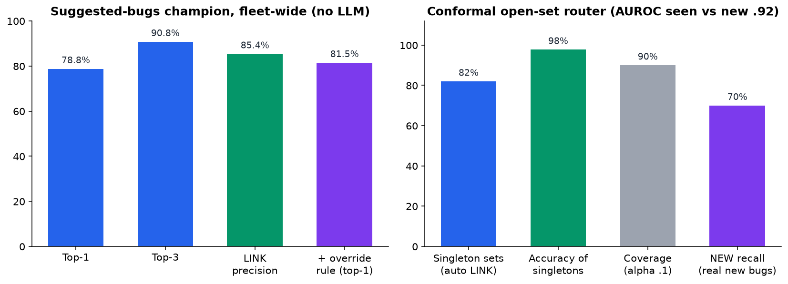
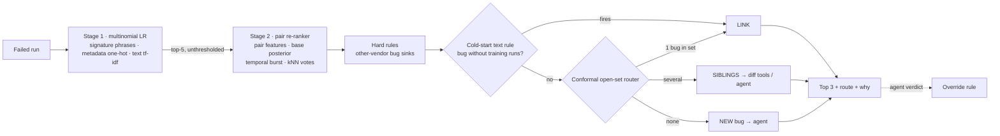
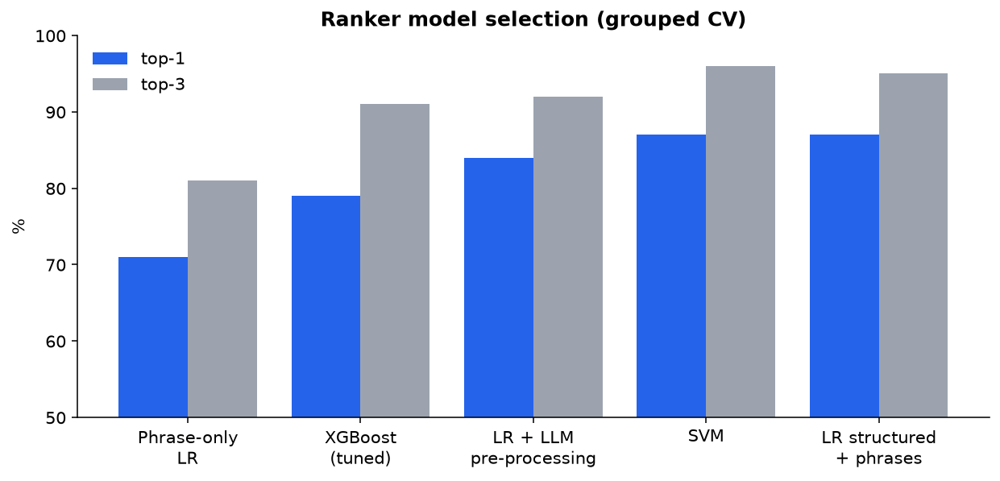
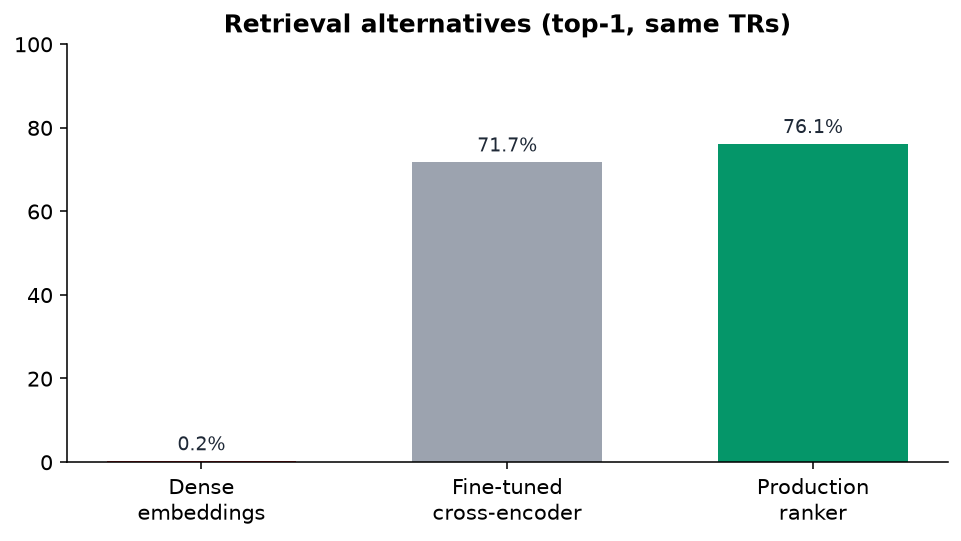

# 1 · Bug classifier: the production "suggested bugs" champion (no LLM)

**What's in production.** Every failed run shows its top 3 suggested bugs, a route and the reasons behind them.
On a frozen fleet snapshot (1,591 runs, 292 bug-linked) it gets **top-1 78.8%, top-3 90.8%** and auto-LINKs 72.6% of
bug runs at **85.4% precision**. Runs with metadata only (no log window) reach 80.4% top-1 at 93.1% precision.
The classifier is usually more accurate than the root-cause agent, so it is the default. The agent **overrides it only when confidence in the classifier's pick is low**, measured by how many of the known issue's evidence lines are found in the real run logs.

## Role in the latest system
The classifier is still the production "suggested bugs" model, and it is also the **first stage of the root-cause pipeline**: its top-5 is the
shortlist the writer and the matcher work from. It only **suggests a known issue**; it does not explain the failure or trace its root cause, which is the writer's job.

- **Leak-free shortlist.** For the LLM stages the top-5 is produced out-of-fold (`shortlist_oof`): each fold is ranked by a model refit without that fold's labels and links.
- **Recall@5 is the ceiling.** On the newest never-seen cycles (175 failures) it gets the right bug first for **65%** and inside the top-5 for **91%**.
  The writer and matcher lift the final answer to 68.6% there, mostly on bugs the classifier had never seen.
- **Compared on the main board** (258 failures), the ranker alone is right on 74.4%; with the writer, matcher and expert preload the chain reaches 77.5% (p = 0.039).

## Design

| Part | How it works | Why |
|---|---|---|
| **Stage 1** | One LR over three channels. Signature phrases: the bug report's phrases (LLM-extracted once per bug, number-free) matched in the run's logs. Metadata one-hot: test, domain, owner, host, platform. Text: tf-idf of the run's title. Status, CI result and comments are never features (label leak). | Metadata was the biggest lever: phrase-only .71 → .87 top-1 |
| **Candidates** | Top 5 with no probability floor | Stage 2 can only reorder, so recall@K is its ceiling. Moving from 3 to 5 and dropping the 0.02 floor raised recall by 3–8 pts |
| **Stage 2** | Pair LR (C=0.1) over signature coverage, idf-weighted coverage, per-source hits, base posterior, **temporal burst** (the bug's links in the last 7 days) and **kNN votes** of similar past runs | The temporal burst was the strongest cheap signal: +2.6 pts overall, +13 pts on rescues |
| **Open-set router** | Split conformal on the *absolute* top logit, calibrated on runs whose truth was a candidate (α = 0.1) | Softmax conformal can't say NEW (recall 0%); the absolute logit can (AUROC .92). Result: 82% singletons at **97.8% accuracy**, NEW recall .70 |
| **Cold-start rule** | tf-idf of bug reports, used only for bugs with no training runs, above θ (≤ 2% false fires on calibration) | Covers what the classifier can't know: 4/4 correct on new bugs, and 30% fewer agent calls |
| **Explanation** | Coefficient × value per feature, the matched signature lines, and linked runs from the same test or owner | People trust what they can check |
| **Override rule** | The agent's pick replaces the classifier's only when the agent is confident (≥ 0.7), the classifier's pick has weak evidence (probe < 0.34: few of its known evidence lines appear in the real run logs) and the agent's bug has more | Keeps the more accurate model as the default and uses the agent only where the evidence contradicts the classifier |

## Lifecycle (MLOps)
- **Champion / challenger.** Retraining triggers on bootstrap, new bugs, cycle rollover or new links. A challenger
  (hyper-parameter grid) is promoted only if it beats the champion on the same folds of the newest window.
  Every version and run is stored in a registry.
- **Live refit.** The served model also trains on every human link made since the champion was built, at most
  once every 30 minutes.
- **Forward ledger (drift alarm).** Every day, the live answer is recorded for unlinked failures. Later
  predictions are scored against the links people actually made.
- **Guarded recalibration.** When forward LINK precision drops below 85% on 10 or more links, the router is refit
  on base + ledger rows. The refit is kept only if base precision drops by less than 2 pts and ledger precision
  improves. The route is swapped in place, with no rebuild.

## Model selection and what was rejected

| Tried | Verdict |
|---|---|
| XGBoost .79 / SVM .87 (ties LR) / LLM forks .84 | LR kept: as accurate, calibrated, explainable |
| Dense embeddings for log text | MRR 0.002, dropped |
| Fine-tuned cross-encoder | .717 vs .761 |
| LambdaRank, pairwise sibling specialists, TraceSim line weights, typed facts, graph PPR features, prototype kNN | Neutral (±2 runs); kept as code, not in the champion |
| Optuna TPE hyper-parameter search | Slightly better top-1 but worse calibration, so not adopted |
| Majority vote of variants | The oracle union is +4.9 pts but voting can't realise it (+8 / −7). Disagreement is kept as an **ambiguity flag** instead: it catches errors at 4.5× the base rate |

Diagnosing the remaining errors: a third of them involve a true bug with ≤ 3 training runs. The cap is data support
and sibling bugs that the logs can't separate, not the method.

## Files
| File | What |
|---|---|
| `classifier.py` | Stage 1, stage 2, hard rule, conformal router, cold-start rule, `decide`, override rule, registry, ledger, guarded recalibration, out-of-fold shortlist for the LLM stages |
| `ranker.py` | Pair features used by stage 2 (also usable alone as a simple ranker) |
| `failure_ranker_colab.ipynb` | Trains the full champion on synthetic data, shows a decision with its explanation, the override rule, the out-of-fold shortlist and a drift → recalibration cycle |

---
[← Back to the overview](../README.md) · This folder is a curated version (architecture and technique only). The notebook runs on synthetic data; the numbers above come from the real (private) evaluation.
