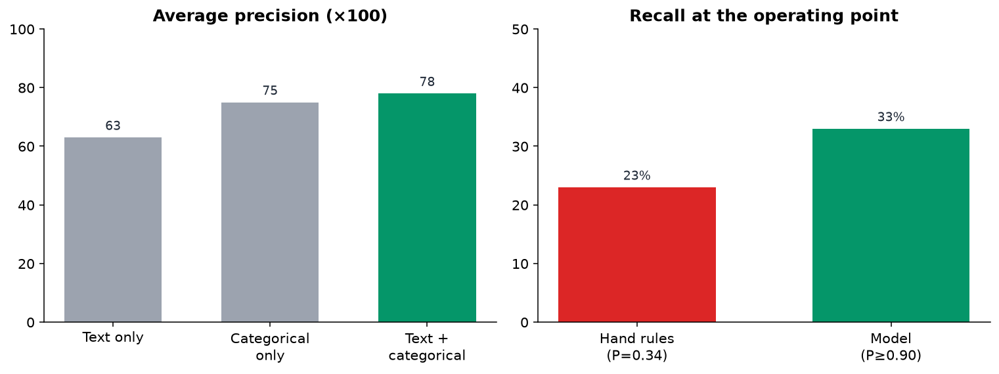
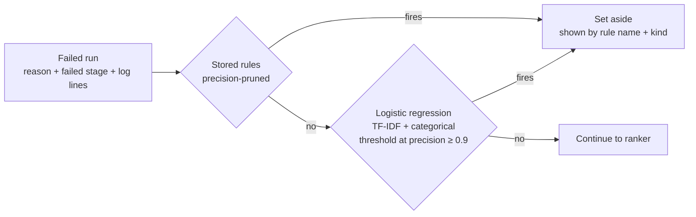

# 2 · Test-issue detector (triage-out)

First step of the guided triage: set aside the failures that are **not product bugs** (lab infrastructure, setup and reporting stages, test content),
so people and the LLM stages focus on real bugs. A false alarm hides a real bug, so **precision matters more than recall**.

## Latest design: two arms, one verdict

| Arm | What it is | Why |
|---|---|---|
| **Stored rules** | Rows in a shared store, each with a kind (`infra` or `test_content`), phrases that must appear and phrases that must not. The same engine evaluates user-created rules, so people add their own in the UI | Explainable: the UI shows which rule fired. Editable without a retrain |
| **Precision pruning** | A rule is kept only if its measured precision on labelled runs is high. Rules from the first version (generic timeout, hang, abort) were dropped because they also matched real bugs | The first hand-written rule set was only 64% precise on held-out runs |
| **Model arm** | TF-IDF on log text plus one-hot categorical metadata in one logistic regression, trained with grouped cross-validation by test family and a threshold at ≥ 0.9 out-of-fold precision | Covers what rules do not, and was the first-version champion |

Base rule families: setup or post-test stage failed, orchestration error (not a verdict), container image not pullable, device table or device missing,
test tool did not complete, pre-run health check failed, run ended mid-cycle.

## Results
| Held-out (runs opened after the training cut) | Non-bugs caught | False alarms on product bugs |
|---|---|---|
| First-version hand-written reason rules | 18 / 101 | 10 / 93 (precision .64) |
| Model arm alone | 15 / 101 | 6 / 93 (precision .71) |
| **Stored, pruned rules** | **16 / 101** | **0 / 93** |
| Product-bug failures on the main board | – | 1 / 376 |

The pruning also used held-out errors, so 0 false alarms is optimistic. The **train-only held-out precision is 0.87**, the honest estimate.
In the first version the model arm reached **AP 0.78** and **33% recall at precision ≥ 0.9** (text only .63, categorical only .75, combined .78).

## Files
| File | What |
|---|---|
| `detector.py` | `IssueDetector` (model arm), `Rule` / `RuleTriage` (stored rules, precision pruning), `Triage` (rules first, then model) |
| `issue_detector_colab.ipynb` | Fits the model arm, prunes candidate rules by precision, and runs the combined verdict on synthetic data |

---
[← Back to the overview](../README.md) · This folder is a curated version (architecture and technique only). The notebook runs on synthetic data; the numbers above come from the real (private) evaluation.
