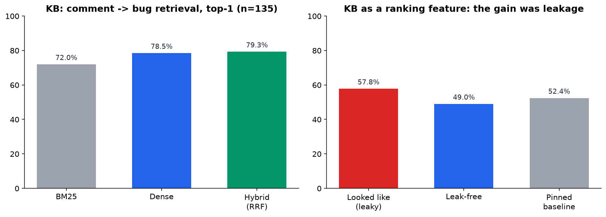
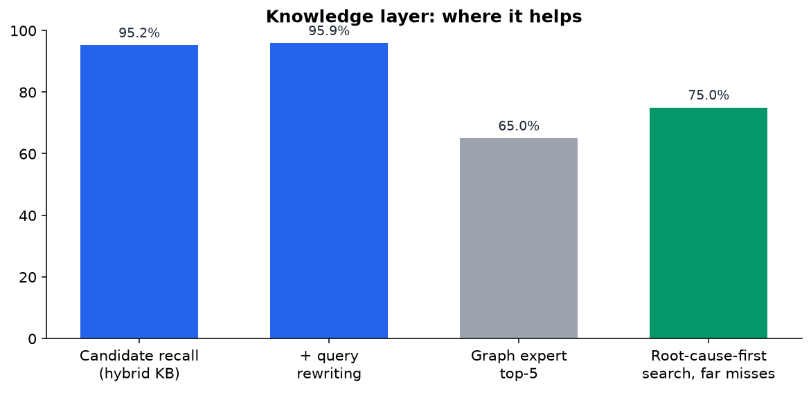

# 3 · Knowledge layer: knowledge base + knowledge graph



Three parts in **one Postgres** (pgvector + Apache AGE, [`schema.sql`](schema.sql)): **bug cards** (structured summaries),
a **knowledge base** of everything people wrote, and a **knowledge graph** of who, what and where around every bug.
They widen the ranker's shortlist, feed the **KG node** of the investigation graph (deterministic facts about each candidate bug, handed to the matcher),
and back the human evidence panel. Measured honestly, they add recall and evidence, not classifier accuracy.

## Knowledge base (documents)
```
reports, discussion threads, run comments
 → clean     strip HTML, mask ids/URLs (queries can't match by number), extract entities (tickets, hex, paths, symbols, log lines)
 → quality   ok | short | noise ("+1", "any update?"); noise is stored but never chunked
 → ingest    content-hash idempotent upsert: re-running changes nothing; edited docs replace their chunks
 → chunk     ≤ 1,100 chars, 120 overlap, cut on sentence boundaries
 → embed     incremental, quality-ok chunks only, halfvec(1024) + HNSW (half the space, same recall)
 → search    BM25 | dense | RRF fusion (k = 60), grouped by bug, time-cut, the run's own comments excluded
```
- **Results.** Comment → bug retrieval top-1: BM25 .72, dense .785, **hybrid .793** (MRR .86).
- **Leakage caught.** Run comments as a classifier feature looked like a gain (.578). The run's own comment was
  leaking the answer: leak-free it's .489, below the .524 baseline, so it isn't wired in. `exclude_run` is now a
  required argument.
- **Operations.** About 2,000 docs and 4,100 chunks (~59 MB with vectors and index). The daily refresh ingests only
  new or edited docs (4 new docs took 17 s). If the embedder is down, search degrades to BM25.

## Knowledge graph (no LLM)
| Layer | Role |
|---|---|
| Curated tables `kg.node` / `kg.edge` | Source of truth, with **provenance + confidence** on every edge, hash-diffed per build |
| openCypher projection (Apache AGE) | Rebuilt from the tables on every build (~10 s) for traversal queries |

- **Model.** Nodes: Run, Bug, Test, Domain, Owner, Cycle, Config, Host, Job, Entity. Edges: `LINKED_TO` (human link,
  conf 1.0 / 0.7 on a passing run), `OF_TEST`, `IN_DOMAIN`, `OWNED_BY`, `RAN_ON`, `ON_CONFIG`, `IN_CYCLE`, `BUILT_BY`,
  `BUG_IN_DOMAIN` (inferred by majority, conf = share), `MENTIONS`, `RELATED_TO`.
- **Pipeline.** extract (no judgement) → **purify** (dedupe, drop self-loops, drop RELATED_TO to unknown ids, keep human
  links to unknown bugs as stubs, **hub filter**: an entity in 1 bug connects nothing and one in more than max(8, 5%) of
  bugs is boilerplate; every rule is counted in a build report) → load (node hash diff) → project (UNWIND batches).
- **Scale.** 3,014 nodes and 14,883 edges, 18 MB, built in 11 s. A second build reports 0 new / 0 changed.
- **Why not GraphRAG.** Its indexing needs an LLM per document, while here nodes and edges come from labelled
  tracker data. Its useful idea, per-domain communities, is kept as a deterministic domain view.
- **Read side (agent tools).** Domain view, bug neighbourhood, **expert search** (the graph picks the domain's bugs,
  the KB ranks their text) and read-only Cypher (200 rows max). Every tool hides the run being debugged and every link
  made after it, with a leak test that has to report 0 leaks.

**KG node: candidate facts for the matcher.** For every shortlisted bug the graph answers, with no model, whether this run shares its test definition,
software stack, host or owner with the bug's earlier linked runs, and whether the bug was filed before the run. The run itself and later links are hidden.
Offline, the true bug shares the **test definition 58% of the time vs 9%** for a wrong candidate, and the **software stack 54% vs 13%**.
That is a cheap, leak-free tie-breaker between sibling bugs whose logs look alike.

**Honest results.** With a time cut, expert search puts the truth in its top 5 for **65%** of bug runs. Without the
cut it looked like 70%, which was leakage, fixed. Personalised PageRank (HippoRAG-style) alone reaches recall@3 .86
but is neutral as a classifier feature: it duplicates the hand-built graph features. The KB and KG back the right
bug and the wrong top-1 equally often (33/70 each), so they are evidence for the agent and humans, not a score.



Bug cards plus query rewriting raise candidate recall from 95.2% to 95.9%. Root-cause-first search put the truth
back in the pool for 15 of 20 far misses.

## Files
| File | What |
|---|---|
| `knowledge.py` | Bug-card prompt and validator, BM25, RRF |
| `kb_store.py` | KB: clean / quality / entities, idempotent ingest, chunking, incremental half-precision embeddings, leak-guarded hybrid search, threads |
| `kg.py` | KG: schema, extract, purify (with report), hash-diff load, Apache AGE Cypher projection, domain/bug/expert views, per-candidate facts (KG node), leak-guarded PPR |
| `schema.sql` | Postgres DDL: pgvector tables + indexes, curated graph tables, build report |
| `knowledge_layer_colab.ipynb` | Builds both on synthetic data, shows why leak guards matter (PPR recall@5 .985 leaky vs .785 leak-free) and the candidate facts: right vs wrong bug |

---
[← Back to the overview](../README.md) · This folder is a curated version (architecture and technique only). The notebook runs on synthetic data; the numbers above come from the real (private) evaluation.
