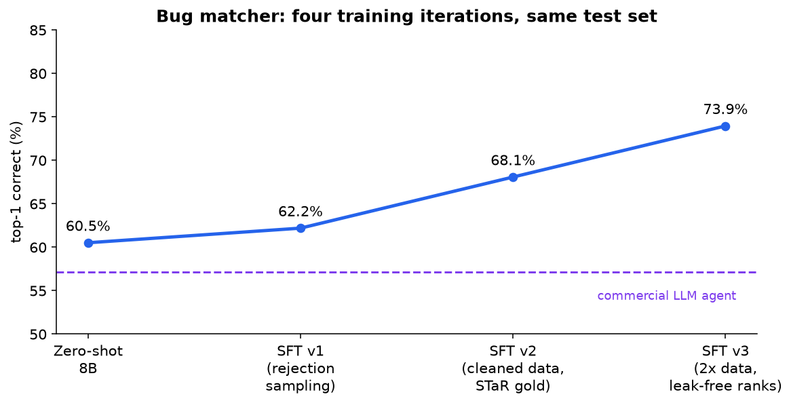
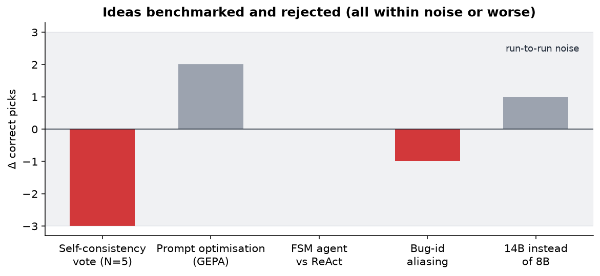

# 4 · Bug matcher (fine-tuned local 8B)

**Champion:** Qwen3-8B, LoRA SFT v3. **88/119 (73.9%) top-1** on the held-out test, **92/119 (77.3%)** with the confidence gate,
and **66.7% on unseen bugs** vs 41.7% for a commercial LLM agent. It runs on one local GPU at zero API cost.

## Role in the latest system
The matcher is the **last model of the chain**. The ranker's out-of-fold top-5 and the DPO-tuned writer's root cause go in, together with the evidence probe and the
graph facts of each candidate, and a bug or `NONE` comes out. The champion adapter was frozen after v3: later gains came from better inputs (writer, expert preload, graph facts), not from retraining it.

| Chain, never changed at inference | Failures | Correct |
|---|---|---|
| Ranker only | 258 | 192 (74.4%) |
| Writer + matcher | 258 | 199 (77.1%) |
| **Writer + matcher + expert preload** | 258 | **200 (77.5%)**, +10 / −2 vs ranker, p = 0.039 |
| Newest unseen cycles: ranker vs writer + matcher | 175 | 114 vs **120**; on never-seen bugs 51 vs **59** of 103 |

## How it got there
| Version | Change | Correct /119 |
|---|---|---|
| Zero-shot 8B | prompt only | 72 |
| SFT v1 | human decisions as targets | 74 |
| SFT v2 | + counterfactual candidates (gold removed → NONE) | 81 |
| **SFT v3** | + STaR-style rationales, out-of-fold ranker scores | **88** |
| Commercial LLM agent | for reference | 68 |

## Training recipe
- Prompt: the writer's root cause + the top-5 candidate bug cards with ranker scores, an **evidence probe** (how many of each bug's known log lines appear in this run) and the **graph facts** of each candidate. Answer: JSON with the bug, a confidence and a short rationale, or `NONE`.
- Loss on completion tokens only. QLoRA (4-bit base, LoRA r=16, alpha 32 on all attention and MLP projections), 3 epochs, LR 1e-4 with cosine decay, effective batch 8, 8k context. Trained with Unsloth + TRL's SFT trainer on Intel XPU GPUs.
- Confidence gate: auto-LINK at p ≥ 0.7, otherwise human review.

## What didn't work

Self-consistency voting (−3), GEPA prompt optimisation (+2, within noise), a finite-state agent (0), bug-ID aliasing (−1),
and a 14B model (+1, not worth twice the compute). Because the 8B is as good, it gets more iterations.

## Files
`matcher.py` (prompt with probe and graph facts, counterfactuals, rationales, Unsloth + TRL `train`, parse, `gated_pick`) · `bug_matcher_colab.ipynb`
(GPU, Qwen3-0.6B on a Colab T4, the same code as the 8B)

---
[← Back to the overview](../README.md) · This folder is a curated version (architecture and technique only). The notebook runs on synthetic data; the numbers above come from the real (private) evaluation.
