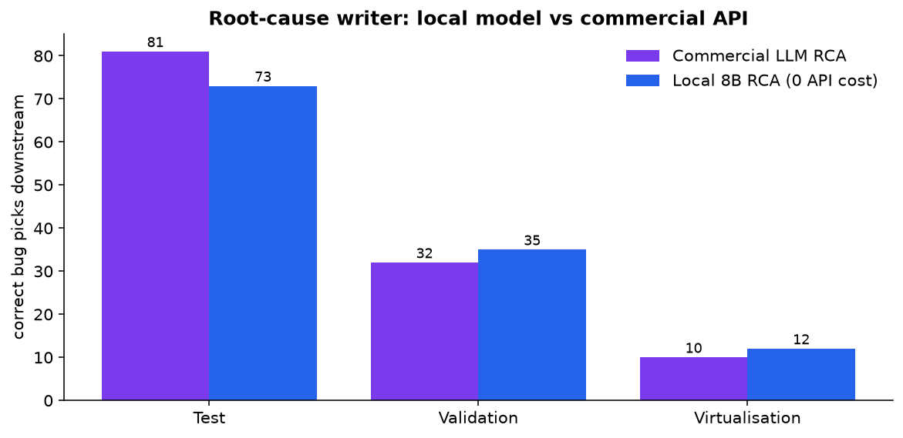
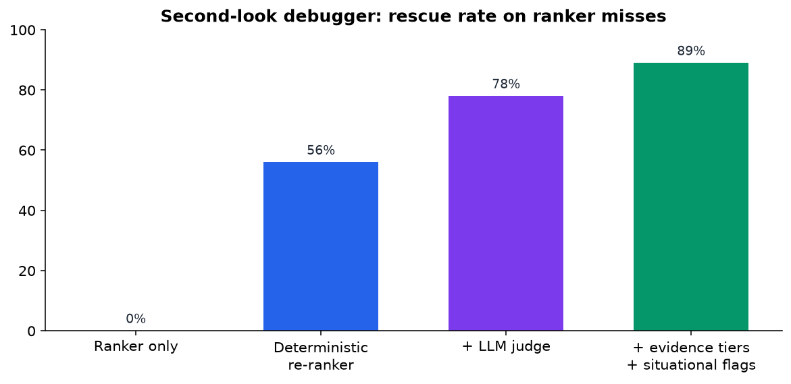

# 5 · RCA agent (tool-using local writer)

**What it does:** like an engineer, the agent calls tools (search logs, read telemetry, look up bug cards, query the graph)
and writes a root-cause analysis that the matcher then reads. The answer is hidden, so the agent has to *find* it.

**Results.** Downstream accuracy with the local zero-shot writer vs a commercial writer:
test 73 vs 81, val **35 vs 32**, virtualisation domain **12 vs 10**. It's competitive at zero cost, and the training
below targets the remaining gap.

**Second-look debugger** (one domain): rescue rate on failures the first pass missed went from **0 → 56%** with deterministic
checks, **78%** with an LLM judge and **89%** with evidence tiers.

## How it works
- A ReAct-style loop with JSON tool calls, a step budget and grounding checks (each claim has to cite evidence).
- Training: LoRA on its own successful trajectories, with loss on assistant tokens only.
  Context up to 16k through chunked causal attention, with checkpoint/resume.
- Next: best-of-N sampling and a critic → DPO preference pairs.

## Files
`rca_agent.py` (tools, agent loop, trajectory encoding, chunked attention, writer training, grounding, critic, preference pairs) ·
`rca_agent_colab.ipynb` (GPU)

---
[← Back to the overview](../README.md) · The notebook runs on synthetic data; the numbers above come from the real (private) evaluation.
