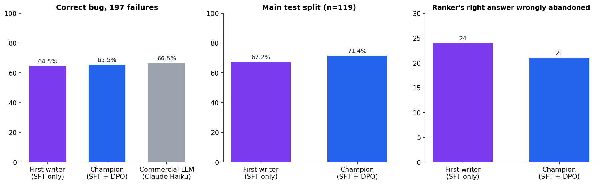
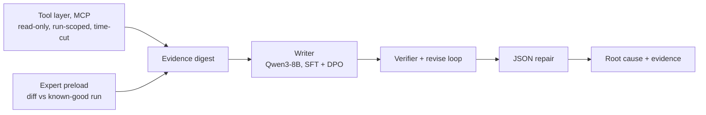

# 5 · RCA writer (local 8B, behaviour cloning then DPO)

**What it does:** reads the evidence of a failed run and writes the **root cause** as an ordered error chain, where every link is a verbatim log line.
The ranker only suggests a known issue; the writer explains *why* the run failed, and the matcher then reads that explanation to pick the bug (or declare a new one).
The answer is hidden, so the writer has to find it in the evidence. *(Formerly called the "RCA agent".)*

**Results.** Same 197 failures, judged end to end through the matcher:

| Writer | Correct bug | Main test split (119) | Ranker's right answer wrongly abandoned |
|---|---|---|---|
| First local writer (behaviour cloning only) | 127 (64.5%) | 80 (67.2%) | 24 |
| **Champion (behaviour cloning + 3 DPO rounds)** | **129 (65.5%)** | **85 (71.4%)** | **21** |
| Commercial LLM (Claude Haiku, reference) | 131 (66.5%) | – | – |

The champion is **statistically tied with the commercial agent** (128 vs 130 on 196 shared failures, McNemar p = 0.79) at zero API cost.
Inside the full chain it is what lifts the final answer to 77.5% on the main board.

## How it works

- **Input.** A digest built by deterministic, read-only tools (run context, log digest, kernel errors of the whole run, typed facts) plus the expert preload.
  The tools come from a **custom MCP server connected to the triage web app**, so the writer's nodes can reach the run's logs and chain several operations on them (read a log window, search kernel errors, extract facts, match a bug's signature). The expert teacher and the local model use exactly the same tools. The champion answers in one pass from the digest;
  the tool-calling loop (`run_agent`) is kept for teacher transcripts and variants.
- **Stage 1, behaviour cloning (SFT).** Supervised fine-tuning on expert transcripts: the model copies correct examples, with loss on the assistant's tokens only.
  QLoRA on Qwen3-8B, 16k-token context through chunked causal attention, checkpoint and resume.
- **Stage 2, DPO (Direct Preference Optimization).** Instead of copying one example, the model sees *pairs* of answers for the same run, a good one and a bad one,
  and is trained to prefer the good one relative to a frozen reference (the same model with the adapter off). No separate reward model is needed.
  Each round: sample 4 answers per run, score them with a critic, build pairs, train. **The champion is the third round.**
  - **Critic.** Agreement with the matcher's verdict plus *grounding*, the share of cited evidence lines that really appear in the evidence given (invented log lines are penalised).
  - **Loss.** `-log σ(β·margin) + α·NLL(chosen)` with β = 0.1: the preference term, plus a likelihood term on the chosen answer that keeps the JSON format stable.
  - **Memory trick.** Two 16k-token sequences do not fit at once, so the pair weight is computed without gradients and each side is back-propagated alone with its exact coefficient.
- **Repair.** A deterministic, model-free salvage for the rare degenerate output (repetition loops, unclosed brackets): 28 outputs needed it for the first writer, 4 for the champion.

**What DPO changed.** Accuracy is similar overall, but the champion is better where it matters: more correct on the main test split, fewer times it talks the system out of a correct ranker answer, and far fewer broken outputs.

## What didn't work
Reinforcement learning on the writer (GRPO and PPO variants), larger thinking budgets, search-based inference (MCTS), model ensembles, a 12B model and a 14B model were all measured
and none beat this design significantly, so the simpler SFT + DPO recipe is the one that ships.

## Files
| File | What |
|---|---|
| `rca_writer.py` | Tools, evidence digest, writer pass, tool loop, deterministic repair, behaviour-cloning trainer, chunked attention, critic, preference pairs, `train_dpo`, `dpo_rounds` |
| `rca_writer_colab.ipynb` | GPU. Qwen3-0.6B on a Colab T4, same code as the 8B: tools, zero-shot, behaviour cloning, best-of-N, critic, pairs, one DPO step |

---
[← Back to the overview](../README.md) · This folder is a curated version (architecture and technique only). The notebook runs on synthetic data; the numbers above come from the real (private) evaluation.
