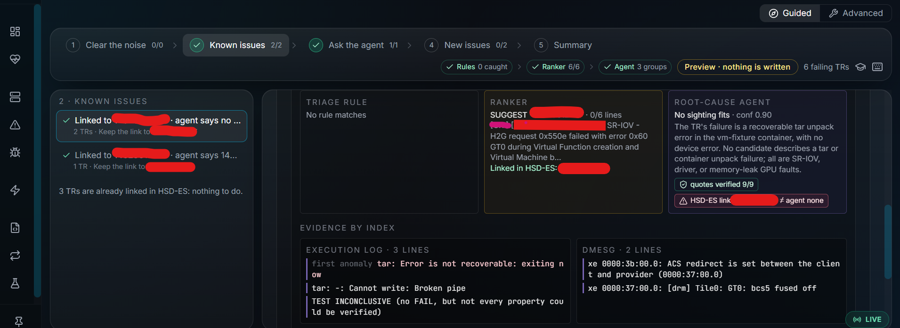
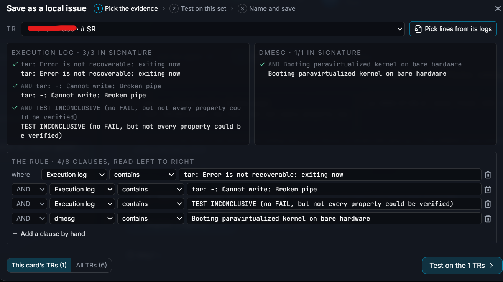
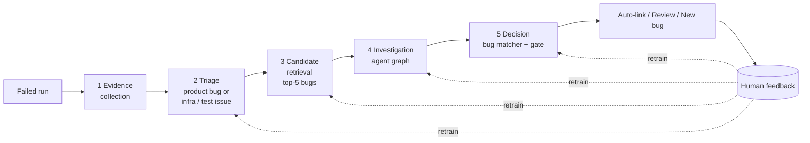
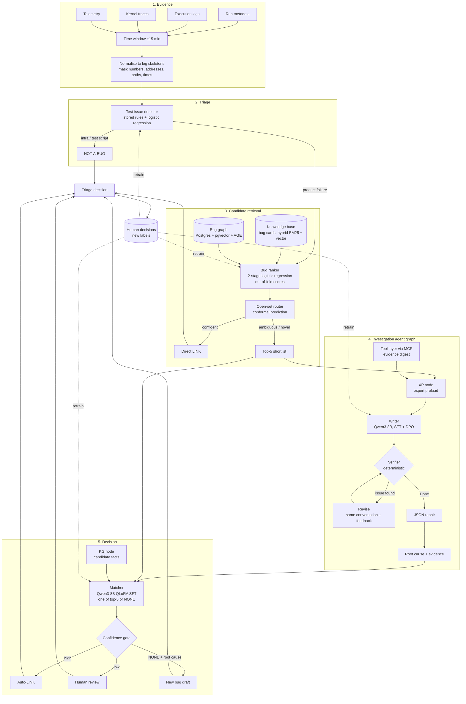

# Expert Debugger: AI triage for large-scale hardware validation

An AI system that reads a failed validation run (logs, kernel traces, telemetry, test metadata) and either
**links it to the known bug that caused it, explains the root cause, or declares it a new bug**.
It combines classic ML, retrieval, a knowledge graph, an LLM agent graph and a fine-tuned LLM judge,
trained on several years of human triage decisions. Every model is **served on local GPUs at zero API cost**.

**Deployed and available to debuggers.** The system is integrated into the validation team's triage web app, where debuggers use it daily
on live failures. A guided flow walks them from noise filtering to known issues, the agent's root cause and new issues,
and nothing is written back to the bug tracker until they confirm. The models are served with **vLLM on Intel XPU GPUs**.

*The guided triage UI. For each failing run it shows the triage-rule verdict, the ranker's suggested known issue, the root-cause agent's
conclusion with its verified evidence quotes, and the raw log and kernel-trace lines behind it. Identifiers are redacted.*

**Debuggers teach the system.** From the same screen a debugger can turn what the agent found into a **rule** and save it: for a **known issue**,
a **new issue** (a product failure) or a **local test issue**. The rule starts from the ranker's evidence or the lines the agent quoted, and the debugger **tweaks it** here (add, remove or edit lines) and tests it on existing failures before declaring it.
The ranker works from metadata alone and does not read these rules, but each saved rule becomes a new label that **strengthens it when it is next fine-tuned**,
and it immediately sharpens the agent's verdicts.

*Declaring a rule from the UI: pick the evidence, test it, name and save it. Identifiers are redacted.*

## Repository index

**This README is the overview and is recommended reading first.** Each layer has its own folder with a `README.md`, the model code and a Colab notebook:

| Folder | Layer |
|---|---|
| [00-architecture](00-architecture) | End-to-end flow and data pipeline |
| [01-failure-ranker](01-failure-ranker) | Bug classifier (ranker) |
| [02-test-issue-detector](02-test-issue-detector) | Infra and test-issue filter |
| [03-knowledge-layer](03-knowledge-layer) | Knowledge base and bug graph |
| [04-bug-matcher](04-bug-matcher) | Fine-tuned bug matcher |
| [05-rca-writer](05-rca-writer) | Root-cause writer (SFT + DPO) |

The code in those folders is a **curated version**: it keeps the overall architecture and the technical approach, and strips implementation specifics
that touch sensitive enterprise data. The notebooks run on **synthetic data**, so the code paths match the real ones without exposing real data.

## Results

Evaluation is leak-free: the answer is hidden at test time, the bug pool is cut off at the run date, and
splits are grouped by bug, so no bug appears in both train and test.

The system went through two versions. Version 1 was a matcher on top of a classic ranker. After a round of research and training
(behaviour cloning, preference tuning, an expert-context node, a verify-and-revise loop), version 2 adds a root-cause writer
and improves accuracy on every board, most on bugs the system has never seen.

### Version 1: first version (2026-11-05)

119 failures with a known bug, 72 of them bugs never seen in training.

| System | Top-1 correct | Unseen bugs (n=72) | API cost |
|---|---|---|---|
| No-LLM ranker (classic ML) | 69.7% | 63.9% | 0 |
| Commercial LLM agent + confidence gate | 73.1% | 41.7% | per call |
| **Local fine-tuned 8B matcher** | **73.9%** | **66.7%** | **0** |
| **Local 8B matcher + confidence gate** | **77.3%** | – | **0** |

| Fleet-wide (1,591 runs) | Result |
|---|---|
| Production classifier, top-1 / top-3 (no LLM) | **78.8% / 90.8%** |
| Precision on runs auto-linked without a human | **85.4%** |

### Version 2: latest champions (frozen 2026-11-09, wired and evaluated through 2026-11-19)

| System | Failures | Correct | Accuracy | Notes |
|---|---|---|---|---|
| Classic ML ranker only | 197 | 137 | 69.5% | Suggests a known issue, no root cause |
| Commercial LLM agent (reference) | 197 | 131 | 66.5% | API cost per call |
| **Local 8B writer, DPO champion** | 197 | **129** | **65.5%** | Tied with the commercial agent (128 vs 130 on 196 shared, McNemar p = 0.79), 0 API cost |
| Classic ML ranker only | 258 | 192 | 74.4% | No LLM |
| **Local writer + matcher + expert preload** | 258 | **200** | **77.5%** | +10 / −2 vs ranker only, p = 0.039 |
| Classic ML ranker only (newest unseen cycles) | 175 | 114 | 65.1% | Held-out, never used for any decision |
| **Local writer + matcher (newest unseen cycles)** | 175 | **120** | **68.6%** | On bugs the ranker never saw: **59 vs 51 of 103** |

The ranker only suggests the most similar known issue. It cannot explain why the failure happened or trace the root cause.
That is why the writer matters even at a slightly lower top-1 (65.5% vs 69.5% alone): it produces the evidence-cited root cause,
and combined with the matcher the chain beats the ranker on every board, mainly on bugs the ranker has never seen.

**First local writer vs the latest champion** (same 197 failures, both after the same deterministic JSON repair)

| | First local 8B writer | Latest champion |
|---|---|---|
| Models | Qwen3-8B writer `w1-bc` | Writer `r3-dpo-w1a` + matcher `v3-8b` (both Qwen3-8B) |
| How it was tuned | Behaviour cloning (SFT): copy expert-written root causes | Same start, then 3 rounds of **DPO** |
| Correct bug, all 197 | 127 (64.5%) | **129 (65.5%)** |
| Correct bug, main test split (119) | 80 (67.2%) | **85 (71.4%)** |
| Ranker's right answer wrongly abandoned | 24 | **21** |
| Ranker's right answer kept | 113 | **116** |
| Outputs needing repair (repetition loops, broken JSON) | 28 | **4** |
| Picks a bug among the shortlist | Writer only | **Plus a fine-tuned matcher: 66.7% on unseen bugs** |

*DPO (Direct Preference Optimization):* instead of copying one example answer, the model sees pairs of a good answer (right bug, evidence quoted verbatim)
and a bad one, and is nudged to prefer the good. The first writer only imitates; the champion also learns what to avoid, so it makes fewer harmful changes and fewer broken outputs.

**Why it matters**
- Matches a commercial LLM agent on quality and beats it by about 25 points on bugs never seen in training (version 1 benchmark).
- Adds a root-cause explanation the ranker cannot give, at the same accuracy level.
- Zero marginal cost and no data leaves the machine.
- Auto-links the confident cases and routes the rest to a human, so engineers review fewer runs.
- Every answer is backed by cited log evidence, and every human decision feeds the next retrain.

## System overview

## Engineering highlights and stack

- **Leak-free evaluation.** Hidden answers, time-cut bug pool, bug-grouped splits, out-of-fold features, and a leaking feature caught and removed.
- **Small models, big result.** Local 8B models tie a commercial agent and generalise better to unseen bugs.
- **Honest comparisons.** Paired significance tests (McNemar) decide what ships; gains within noise are not claimed.
- **Deterministic where possible.** Triage rules, verifiers, JSON repair and graph facts are plain code, so the LLM only does what needs judgment.
- **Negative results kept.** Self-consistency voting, prompt optimisation, finite-state agents, larger models, reinforcement-learning variants and search-based inference were measured and did not beat the chosen design.

| Tool | Where it is used in the system | What it does there |
|---|---|---|
| **Python, NumPy, scikit-learn** | Ranker, test-issue detector, features | Logistic regression, TF-IDF, calibration, out-of-fold stacking |
| **Conformal prediction** | Open-set router, confidence gate | Decides link, sibling candidates or new bug with controlled error |
| **Hybrid retrieval (BM25 + vectors, rank fusion)** | Knowledge base | Finds past bug discussions similar to the failure |
| **PostgreSQL, pgvector, Apache AGE** | Knowledge base and bug graph | One database for vector search and typed graph queries |
| **Knowledge graphs** | KG node | Deterministic facts per candidate bug (same test definition, stack, host, owner) |
| **PyTorch, Hugging Face Transformers** | All LLM stages | Model loading, generation, training loops |
| **Unsloth** | Writer and matcher training | Open-source library that makes LLM fine-tuning faster and lighter on memory, so an 8B model trains on a single GPU with long-context prompts |
| **PEFT (LoRA / QLoRA), bitsandbytes 4-bit** | Writer and matcher training | Train small adapter layers on a 4-bit compressed base model instead of all weights |
| **TRL (Hugging Face)** | Writer and matcher training | Library for training LLMs after pre-training, used for the two methods below |
| **SFT (supervised fine-tuning)** via TRL | Matcher, writer behaviour cloning | Teach the model by showing correct input-output examples (evidence to bug, evidence to root cause) |
| **DPO (direct preference optimization)** via TRL | Writer | Teach the model from pairs of good vs bad answers, with no separate reward model |
| **Qwen3-8B** | Writer and matcher | Local open-weights base model |
| **LLM agents** | RCA writer | Writes the evidence-cited root cause from a prepared evidence digest |
| **Model Context Protocol (MCP)** | Tool layer | Standard tool server (metadata, log windows, search, facts) that builds the evidence the writer reads |
| **Agent graph (LangGraph-style state machine)** | Investigation stage | Nodes, verify-revise loop, Done exit with a step cap |
| **vLLM** | Inference | High-throughput LLM serving engine (continuous batching, OpenAI-style API), one endpoint per model, no external API |
| **Intel XPU GPUs** | Training and inference | All fine-tuning and serving run on Intel data-centre GPUs (XPU backend for PyTorch and vLLM) |
| **RLHF-family experiments (GRPO, PPO, best-of-N, MCTS)** | Research track | Tested against the SFT + DPO champion, not adopted |
| **Statistics (McNemar, bootstrap CIs)** | Evaluation | Promote a model only if it beats the champion significantly |
| **Docker / sandboxed XPU hosts** | Training and evaluation | Reproducible runs, checkpoint and resume, isolating rows that crash a device |

## Data flow in detail

## Main components

| Component | What it is | Latest version | Result |
|---|---|---|---|
| **Test-issue detector** | Filters infra and test-script failures before any bug search. Stored, editable rules plus a logistic regression on the run's failure digest | Rules + LR, threshold set at ≥ 0.87–0.9 precision | 0 of 93 product-bug failures wrongly filtered on held-out runs |
| **Ranker** | Scores every open bug against the failure and keeps the top 5. It only suggests a known issue; it does not trace the root cause | Out-of-fold 2-stage logistic regression + conformal open-set router | 78.8% top-1, 90.8% top-3 fleet-wide; gold bug in the top 5 for 91% of the newest unseen runs |
| **Knowledge base and graph** | Searchable bug cards and a typed graph of bugs, tests, stacks and hosts in one Postgres | Hybrid retrieval + AGE graph | Candidate recall 95.9%, hybrid top-1 0.793 |
| **XP node (expert preload)** | Adds expert context to the writer's prompt before it starts: diff against a known-good passing run, the test definition card and domain-expert notes | Deterministic, no model | 77.5% vs 74.4% for the ranker alone on the main board, with fewer broken answers |
| **Writer** | Reads the evidence digest and writes the root cause as an ordered error chain, each link a verbatim log line | Qwen3-8B, 4-bit QLoRA, behaviour cloning then 3 rounds of DPO | 129 of 197, tied with a commercial agent at zero cost |
| **Tool layer (MCP)** | Metadata, windowed log reader, kernel-error search over the whole run, typed fact extraction, cross-run pattern match | 7 tools, outputs capped | Builds the evidence the writer and verifier work from |
| **Verifier** | Deterministic checks on the writer's answer: severe signatures never mentioned, evidence lines not found in the given evidence, test-content vs product contradictions | Plain code, free to run | Drives the revise loop |
| **Agent graph loop** | `XP → Writer → Verifier → (Revise → Verifier)* → Done`. Exits when verified, stable, no valid output, or the step cap is hit | Explicit state machine, LangGraph-style, plain Python | Paired no-loop vs loop scoring on every run |
| **KG node** | Looks up deterministic facts per candidate bug (same test definition, stack, host, owner, filed before this run) and feeds them to the matcher | Graph queries, no model | Gold bug shares the test definition 58% of the time vs 9% for wrong candidates |
| **Matcher** | Reads evidence, root cause and shortlist and picks one bug or NONE | Qwen3-8B, 4-bit QLoRA SFT, 8k context | 73.9% top-1, 66.7% on unseen bugs |
| **Confidence gate** | Auto-link when sure, human review otherwise, new-bug draft on NONE | Calibrated thresholds | 85.4% precision on auto-links, 77.3% top-1 with the gate |
| **Feedback loop** | Human decisions become labels for the next retrain | Out-of-fold, grouped splits | – |

## Data pipeline

1. **Collect.** Run, its logs and telemetry within ±15 minutes, and the bug tracker's link history.
2. **Normalise.** Mask numbers, addresses, paths and timestamps into a *log skeleton*, so the same failure looks the same across machines.
3. **Label.** Human triage decision (linked bug, or not-a-bug) is ground truth.
4. **Split, leak-free.** Group by bug, split by time, flag bugs never seen in training as "unseen".
5. **Out-of-fold features.** Ranker scores given to the LLMs are produced out-of-fold, so no model trains on scores that saw its own label.

See [00-architecture/data_pipeline.py](00-architecture/data_pipeline.py).

## Roadmap

- Reinforcement learning on the full debugger loop (RCA, classifiers and tool calls on the logs).
- Novel-bug evaluation: report "matched existing" separately from "correctly declared new bug + root cause".
- Grow the bug graph and knowledge base from new triage decisions.

*Personal portfolio summary. Numbers are aggregates, and all names, systems and data are abstracted.*
