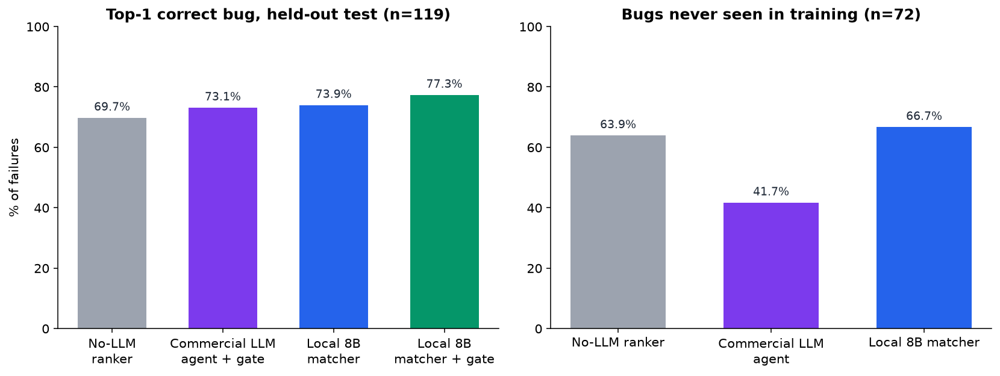
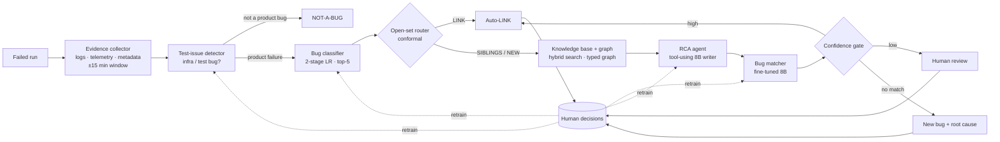

# Expert Debugger: AI triage for large-scale hardware validation

An AI system that reads a failed validation run (logs, telemetry and test metadata) and either
**links it to the known bug that caused it, explains the root cause, or declares it a new bug**.
It's built from five models, trained on several years of human triage decisions and served
**fully on local GPUs at zero API cost**.

## Results

The test set holds 119 failures whose bug is known. The answer is hidden at test time, the bug pool is cut
off at the run date, and the split is grouped by bug, so no bug appears in both train and test.

| System | Top-1 correct | Unseen bugs (n=72) | API cost |
|---|---|---|---|
| No-LLM ranker (classic ML) | 69.7% | 63.9% | 0 |
| Commercial LLM agent + confidence gate | 73.1% | 41.7% | per call |
| **Local fine-tuned 8B matcher** | **73.9%** | **66.7%** | **0** |
| **Local 8B matcher + confidence gate** | **77.3%** | – | **0** |

Across the whole fleet (1,591 runs), the production classifier alone (no LLM) reaches **78.8% top-1 and 90.8% top-3**, and
**85.4% precision** on the runs it auto-links without a human.

## Architecture

| # | Model | Role | Champion | Folder |
|---|---|---|---|---|
| 1 | Bug classifier (production champion) | Suggests bugs for every failure, no LLM | 2-stage LR + conformal open-set router + cold-start rule: 78.8% top-1, 90.8% top-3, 85.4% LINK precision (81.5% with the override rule) | [01-failure-ranker](01-failure-ranker) |
| 2 | Test-issue detector | Filters infra and test-script failures | TF-IDF + categorical LR, AP .78 | [02-test-issue-detector](02-test-issue-detector) |
| 3 | Knowledge base + knowledge graph | Searchable bug discussions, typed bug graph (one Postgres: pgvector + Apache AGE) | Hybrid retrieval .793 top-1, graph expert top-5 65% (time-cut), candidate recall 95.9% | [03-knowledge-layer](03-knowledge-layer) |
| 4 | Bug matcher | Picks the bug from the shortlist | Qwen3-8B SFT v3, 88/119 | [04-bug-matcher](04-bug-matcher) |
| 5 | RCA agent | Investigates with tools, writes the root cause | Local 8B agent + evidence tiers | [05-rca-agent](05-rca-agent) |
| – | End to end | Data pipeline and the whole decision flow | – | [00-architecture](00-architecture) |

Every folder has a `README.md`, the model code (`.py`) and a Colab notebook that runs on **synthetic data**:
the real data is private, but the code paths match the real ones.

## Data pipeline

1. **Collect.** Pull the run, its logs and telemetry within ±15 minutes, and the bug tracker's link history.
2. **Normalise.** Mask numbers, addresses, paths and timestamps into a *log skeleton*, so the same failure
   looks the same across machines.
3. **Label.** Use the human triage decision (linked bug, or not-a-bug) as ground truth.
4. **Split, leak-free.** Group by bug, split train/val/test by time, and flag bugs never seen in training as
   "unseen".
5. **Out-of-fold features.** The ranker's scores fed to the LLMs are produced out-of-fold, so no model
   is ever trained on scores that already saw its own label.

See [00-architecture/data_pipeline.py](00-architecture/data_pipeline.py).

## Engineering highlights

- **Leak-free evaluation.** The answer is hidden, there's a time cut on the bug pool, and splits are
  grouped by bug. One feature that looked like a gain turned out to be leakage, and it was caught and removed.
- **Local fine-tuning on data-centre GPUs (XPU).** LoRA with Unsloth on Qwen3-8B, 16k-token context
  through chunked causal attention, checkpoint/resume, and rows that crash the device are isolated and skipped.
- **Negative results are kept.** Self-consistency voting, prompt optimisation (GEPA), a finite-state agent,
  bug-ID aliasing and a 14B model were each measured and rejected (see 04).
- **Cost.** The local 8B models match or beat the commercial agent at zero marginal cost, and do much better
  on unseen bugs.

## Roadmap

- Preference training (best-of-N, DPO) on RCA writer samples, with a critic model as the judge.
- Novel-bug evaluation: report "matched existing" separately from "correctly declared new bug + root cause".
- More tools for the agent, and growing the bug graph and knowledge base from new triage decisions.

*Personal portfolio summary. Numbers are aggregates, and all names, systems and data are abstracted.*
